# Pouch walkthrough

A visual tour of BayLeaf Pouch by persona and journey. Each picture is a crop of the
real app. Each caption carries the [JOURNEYS.md](JOURNEYS.md) story IDs it illustrates,
with their current status. For how things work and why, see [README.md](README.md).
For what is decided but not built yet, see [NEXT.md](NEXT.md).

**How this page stays current.** Run `node walkthrough.mjs` (or `node build.mjs
--walkthrough`). It bundles the app from `src/` with a scripted fake model in place
of the Sealed client, replays the scenes in
[walkthrough/scenes.mjs](walkthrough/scenes.mjs) in headless Chromium, and crops
each shot to the element that matters. No request leaves the machine. An image is
rewritten only when its pixels really changed. The script rewrites only the regions
between `wt:` marker comments: the image blocks (picture, alt text, story tags,
caption), the one-line status rows under each heading, and the coverage list at the
end. Statuses come from JOURNEYS.md at run time. Everything outside the markers,
including this prose, is hand-written. A scene that names a story missing from
JOURNEYS.md fails the run, and so does a declared shot that this page does not place.

Two things the pictures hide. First, the clock is fixed at 9:41 AM and elapsed times
are frozen (4s, 12s), so reruns are pixel-identical. Second, flows that depend on how
a real model behaves (agent graphs, watching files, the Local lane, the analyst
script) are **scripted reenactments**: the fake model follows the outline of a
recorded real run from the AX notes in JOURNEYS.md, and their captions say so.
Statuses read: **ok** built and tested, **built, untested**, **gap** missing,
**built** for a lane that is tested only by hand.

## 1. Arriving: Lab and Auditor

<!-- wt:status A1 A2 A5 A6 T1 T2 T3 T4 --><b>A1</b> ok · <b>A2</b> ok · <b>A5</b> ok · <b>A6</b> ok · <b>T1</b> ok · <b>T2</b> ok · <b>T3</b> ok · <b>T4</b> ok<!-- /wt -->

A student on a borrowed lab computer opens the page. There is no account and no
install, and the files and the editor work at once. The first visit gets one card
that says what Pouch is, where files live, and what to do before leaving a borrowed
machine.

<!-- wt:shot arrive-welcome -->
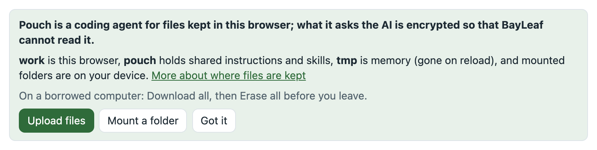 
<b>A5</b> ok · <b>L3</b> ok. One screen says what Pouch is and where files are kept; dismissing it is remembered.
<!-- /wt -->

On the campus network, Campus Pass sends without signing in. The Usage panel is
honest that this allowance is shared by everyone behind the same network address.

<!-- wt:shot arrive-usage -->
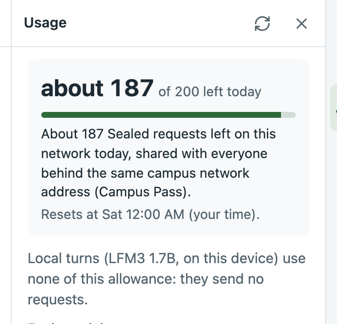 
<b>A2</b> ok · <b>A6</b> ok. Campus Pass needs no sign-in; the allowance is shared by the network address, and the reset time is stated.
<!-- /wt -->

The Auditor persona starts at the shield. The trust panel says, in the page itself,
what BayLeaf can and cannot see. It names api.bayleaf.dev as the only network peer
and shows how to check the build against the release's SHA256SUMS. The page cannot
honestly show its own hash, so it shows a build id and a recipe (T3, revised).

<!-- wt:shot arrive-trust -->
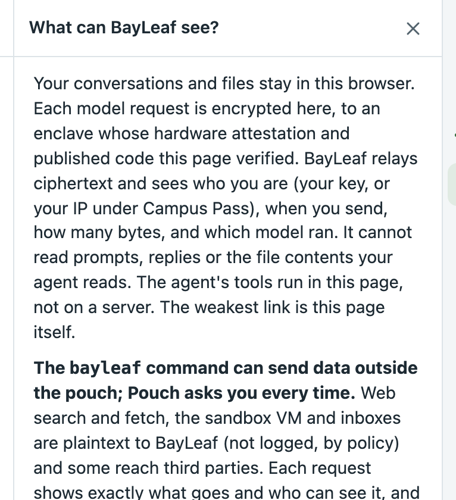 
<b>T1</b> ok · <b>T2</b> ok · <b>T3</b> ok · <b>T4</b> ok. What BayLeaf can see, stated in the page: attestation facts, one peer (api.bayleaf.dev), and how to check the build.
<!-- /wt -->

## 2. A first real edit: Desk

<!-- wt:status D1 D2 D11 D23 R1 R2 R3 R4 R5 R7 A7 --><b>D1</b> ok · <b>D2</b> ok · <b>D11</b> ok · <b>D23</b> ok · <b>R1</b> ok · <b>R2</b> dropped by decision 2026-10-29 · <b>R3</b> dropped by decision 2026-10-29 · <b>R4</b> ok · <b>R5</b> dropped by decision 2026-10-29 · <b>R7</b> ok · <b>A7</b> ok<!-- /wt -->

A TA asks for a fix in plain language. The agent reads, then edits, and the reply is
markdown with a highlighted code block. The turn footer shows the model, the duration
and the time.

<!-- wt:shot desk-turn -->
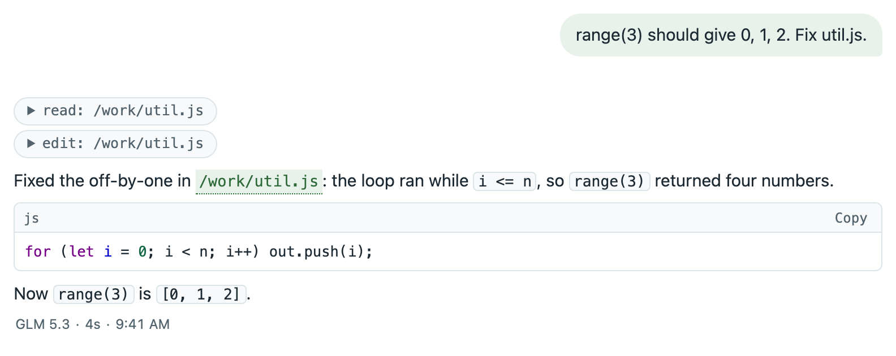 
<b>D1</b> ok · <b>D2</b> ok · <b>D11</b> ok · <b>D23</b> ok · <b>R7</b> ok. Tool calls show as pills while they run; the reply is markdown; the footer names the model, the duration and the time.
<!-- /wt -->

Change review ("Changed N files", the diff view, per-file and per-turn undo) was dropped
by decision on 2026-10-29 as visual clutter and removed on 2026-10-30, so R2, R3 and R5
read dropped above. What stays is R4: when the agent changes the file open in the
editor, the changed lines flash once, and unsaved edits raise the conflict bar.

The frame is chat first: sessions in a collapsible sidebar, and one side panel at a
time from the icon rail.

<!-- wt:shot desk-layout -->
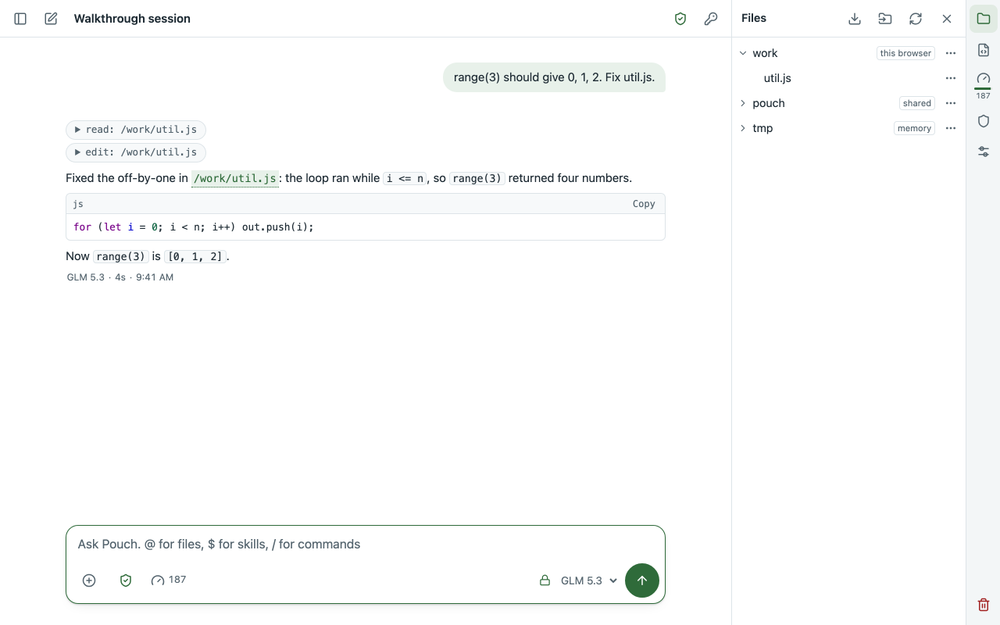 
<b>A1</b> ok · <b>A7</b> ok. Chat first, one side panel at a time from the rail; panels and the sidebar resize and are remembered.
<!-- /wt -->

If you are typing in a file when the agent edits it, the editor keeps your unsaved
edits and asks you which version to keep. This stays after change review goes.

<!-- wt:shot conflict-bar -->
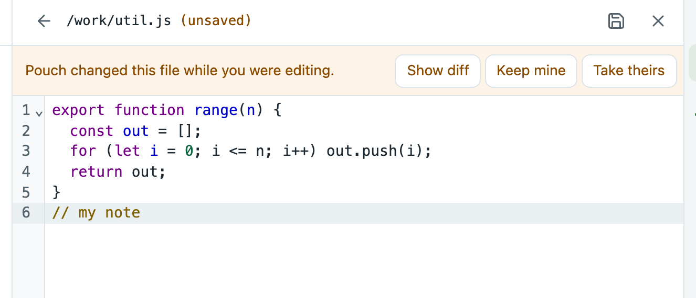 
<b>R4</b> ok · <b>R1</b> ok. The editor follows agent edits to the open file without losing yours: a conflict bar asks which to keep.
<!-- /wt -->

### Sessions and Revert

<!-- wt:status D3 D8 D9 D12 L2 --><b>D3</b> ok · <b>D8</b> ok · <b>D9</b> ok · <b>D12</b> ok · <b>L2</b> ok<!-- /wt -->

Each session is named after its first turn. You can switch, rename, compact or delete
sessions from the sidebar.

<!-- wt:shot sessions-sidebar -->
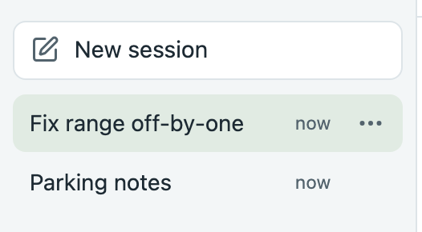 
<b>D3</b> ok · <b>D8</b> ok · <b>D9</b> ok. Sessions are named after the first turn and can be switched, renamed, compacted and deleted from the sidebar.
<!-- /wt -->

Revert to here forks the conversation just after a message, so the model never sees
the later turns, and you can undo the revert. It is conversation-only (2026-10-30):
files stay as they are, and the later messages fold into a dimmed "other branch".

<!-- wt:shot sessions-revert -->
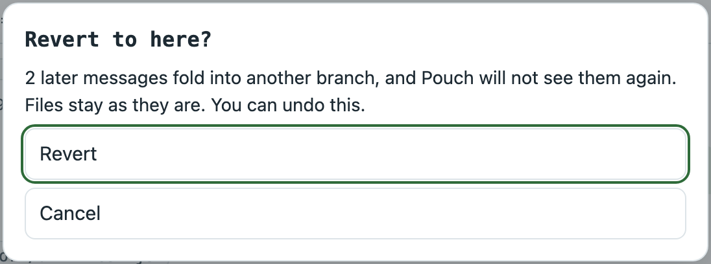 
<b>D12</b> ok. Revert forks the conversation just after a message; later messages fold into a dimmed other branch, files stay as they are, and it can be undone.
<!-- /wt -->

## 3. Bringing files in and pointing at them

<!-- wt:status I1 I4 I5 I6 I8 D17 D20.2 D22 --><b>I1</b> ok · <b>I4</b> ok · <b>I5</b> ok · <b>I6</b> built, untested · <b>I8</b> ok · <b>D17</b> ok · <b>D20.2</b> ok · <b>D22</b> ok<!-- /wt -->

Attach, drop or paste. Files land byte for byte in `/work/.attachments/`, and
nothing is sent until you press Send. This works before signing in.

<!-- wt:shot attach-chips -->
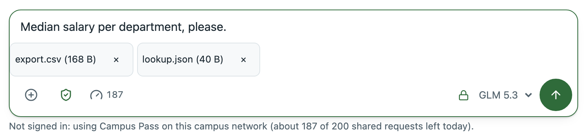 
<b>I8</b> ok. Attach, drop or paste: files land in /work/.attachments/ byte for byte, and nothing is sent until you press Send.
<!-- /wt -->

The composer teaches its own syntax: `@` for paths, `$` for skills, `/` for
commands. Mentioning a file (I6) is this completion. Whether the agent then uses the
file well is still untested.

<!-- wt:shot composer-mention -->
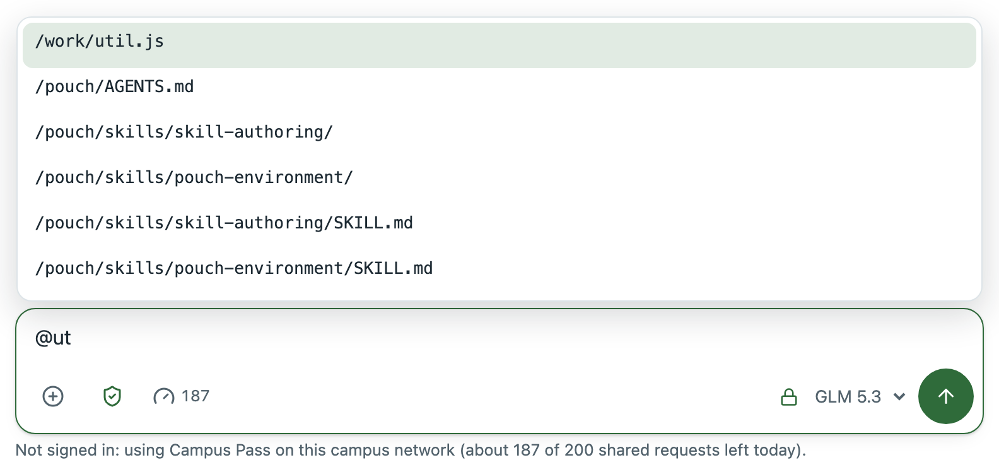 
<b>D22</b> ok · <b>I6</b> built, untested. @ lists paths in /work, /pouch, /tmp and mounted folders; $ lists skills; / lists commands.
<!-- /wt -->

The composer is one card. The shield in it states this session's lane (Sealed:
encrypted to the enclave) and any egress grants, each of which can be revoked.

<!-- wt:shot composer-shield -->
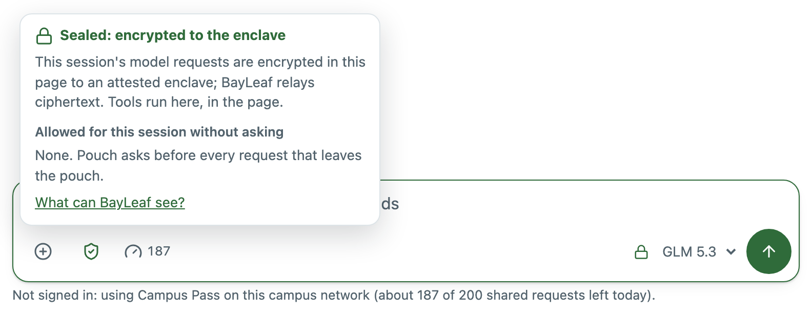 
<b>D20.2</b> ok · <b>D17</b> ok. One card: tray, input, verbs on the left (Attach, the shield, Usage), model and Send on the right.
<!-- /wt -->

## 4. Transforming an export: Analyst and `run`

<!-- wt:status D18 D19 D19.2 D20 D21 --><b>D18</b> ok · <b>D19</b> ok · <b>D19.2</b> ok · <b>D19.2</b> ok · <b>D20</b> ok · <b>D20.2</b> ok · <b>D21</b> ok · <b>D21.2</b> ok<!-- /wt -->

A staff member brings a messy export: quoted fields with commas, doubled quotes,
line breaks, `$85,000` salaries, `n/a` and unknown codes. awk and jq cannot handle it,
so the agent writes a script, runs it in the `run` sandbox (QuickJS in a throwaway
worker with no network), and keeps both the script and the output in /work. In the
recorded real run (t14, glm-5-3) it took eight requests, and the result matched
Python's `csv` module for every department.

<!-- wt:shot analyst-turn -->
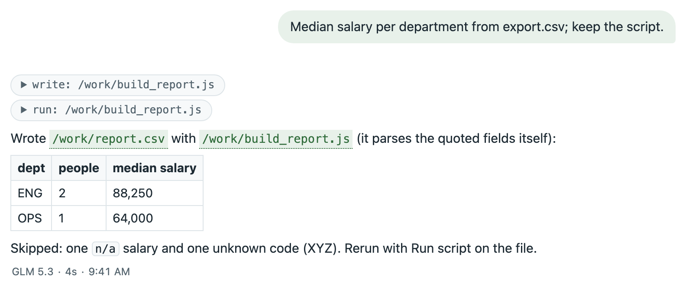 
<b>D19.2</b> ok · <b>D18</b> ok. A quoted CSV that defeats awk becomes a checked report.csv, and the script that made it stays in /work to rerun or hand on. <i>Scripted reenactment with a fake model.</i>
<!-- /wt -->

While a script runs, the tray shows it with its `/task` file. Stop ends that one call,
and the model carries on.

<!-- wt:shot run-tray -->
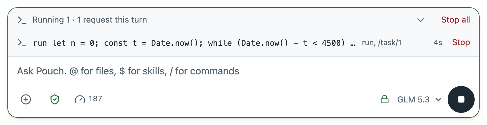 
<b>D18</b> ok · <b>D21.2</b> ok · <b>D19</b> ok · <b>D19.2</b> ok. An in-flight run shows in the tray with its /task file; Stop ends that one call and the model carries on.
<!-- /wt -->

Each task sees a declared view of the files. The trust panel lists every mount
table, one task per block with its mounts beneath, at the panel's default width.

<!-- wt:shot ns-trust -->
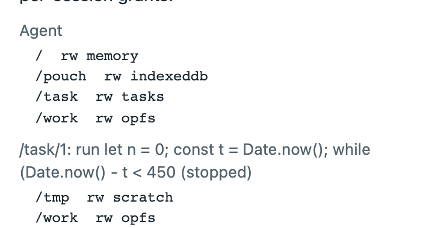 
<b>D20</b> ok · <b>D20.2</b> ok. Every task sees a declared view of the files; the trust panel lists each mount table.
<!-- /wt -->

## 5. Leaving the pouch, with permission

<!-- wt:status D10 D13 D14 I7 O6 --><b>D10</b> ok · <b>D13</b> ok · <b>D14</b> built, untested · <b>I7</b> built, untested · <b>O6</b> gap<!-- /wt -->

Web search, the sandbox VM and inboxes all go through one `bayleaf` shell command,
and every request asks first. The sheet shows the exact payload and who can see it,
and Deny has focus. Only web search has been exercised in the browser. Inboxes "new
since yesterday" (D14) and sealed uploads to the sandbox (O6) are gaps.

<!-- wt:shot egress-sheet -->
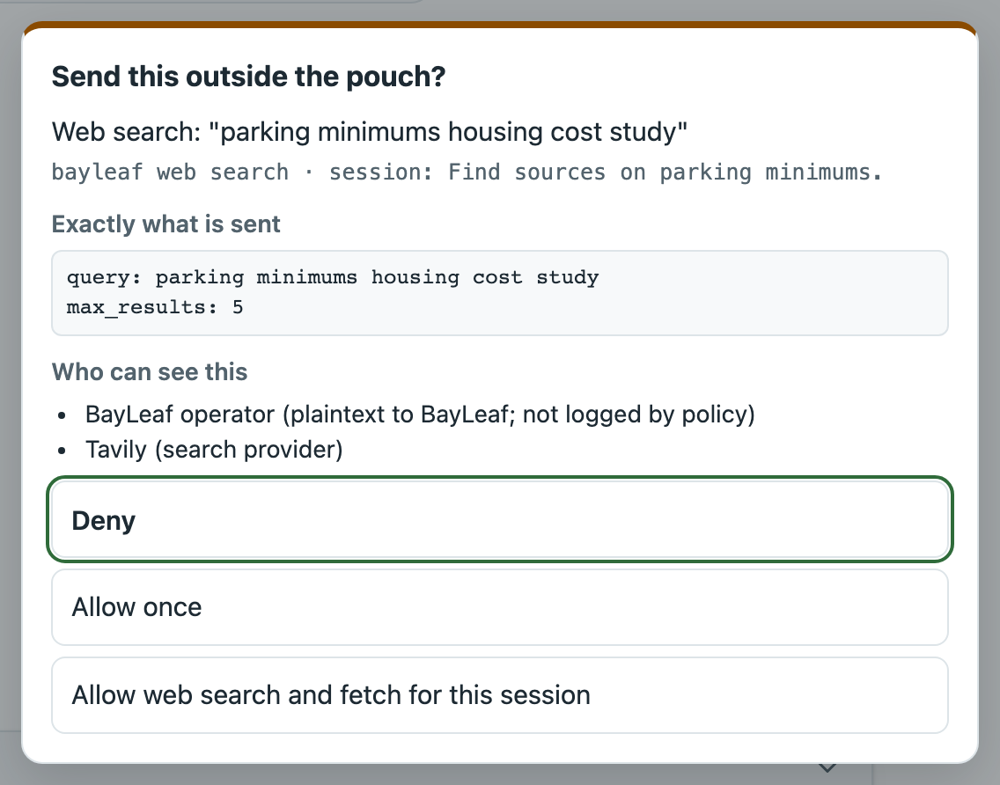 
<b>D10</b> ok · <b>D13</b> ok. Anything that would leave the pouch asks first, showing the exact payload and who can see it; Deny has focus.
<!-- /wt -->

## 6. Subagents, and steering one that is working

<!-- wt:status D15 D16 D16a S1 S2 S3 S4 S5 --><b>D15</b> ok · <b>D16</b> ok · <b>D16a</b> ok · <b>S1</b> ok · <b>S2</b> ok · <b>S3</b> ok · <b>S4</b> ok · <b>S5</b> ok<!-- /wt -->

"Look into parking minimums while we keep going." The agent hands a self-contained
task to a background subagent. Its card sits where it was spawned, and the tray
lists it while it runs.

<!-- wt:shot subagents-tray -->
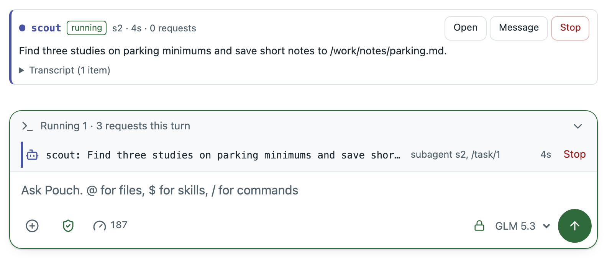 
<b>D15</b> ok · <b>D16</b> ok · <b>D21.2</b> ok. A background subagent: its card sits where it was spawned, and the tray lists it while it runs.
<!-- /wt -->

Running children nest under their session in the sidebar, with a live state.

<!-- wt:shot subagents-sidebar -->
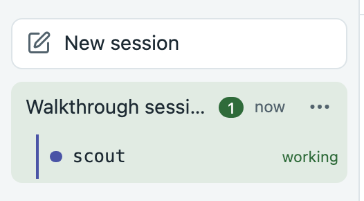 
<b>S1</b> ok · <b>D9</b> ok. Running children nest under their session with a live state.
<!-- /wt -->

Open one to read its transcript as it happens. Its view uses the same composer, so a
message steers it: the subagent reads it at its next step, labeled "You, while it
worked".

<!-- wt:shot subagents-view -->
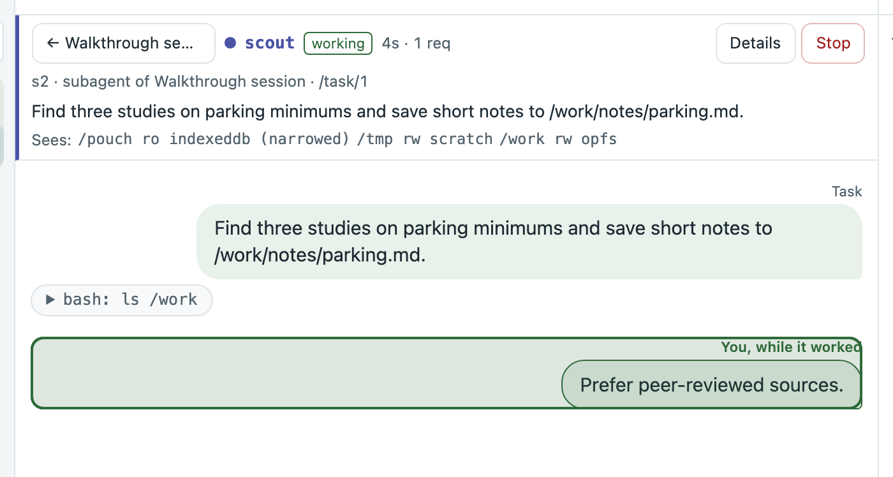 
<b>S2</b> ok · <b>S3</b> ok. Open a subagent to read its live transcript and steer it; the message reaches its next step.
<!-- /wt -->

Back in the parent, the finished card shows a compact transcript with the steering
marked. The report tells the parent model that you steered. One gap remains: a steer
sent in the instant the run ends would start a new turn (S3).

<!-- wt:shot subagents-review -->
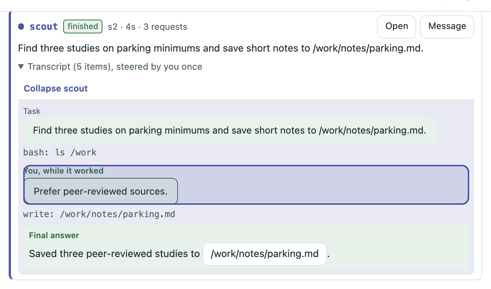 
<b>S4</b> ok · <b>S5</b> ok · <b>D16</b> ok. Back in the parent, the card shows the compact transcript and counts the steering; the report tells the parent model you steered.
<!-- /wt -->

## 7. Agent graphs: a review panel

<!-- wt:status G1 G2 G3 G4 G5 G6 G7 G8 G9 G10 G11 G12 Caps --><b>G1</b> ok · <b>G2</b> ok · <b>G3</b> ok · <b>G4</b> ok · <b>G5</b> ok · <b>G6</b> ok · <b>G7</b> ok · <b>G8</b> ok · <b>G9</b> ok · <b>G10</b> ok · <b>G11</b> ok · <b>G12</b> ok · <b>Caps</b> ok<!-- /wt -->

With the draft open, `$pan` offers the bundled panel skill. Since Batch A it is one-shot:
four judges in one round, each a single request with the draft attached and no tools,
then a one-shot chair that merges their findings (about 9 requests, down from 41 in the
play-test). Each agent wears its own color in the tray, the sidebar and its card.

<!-- wt:shot graph-skill -->
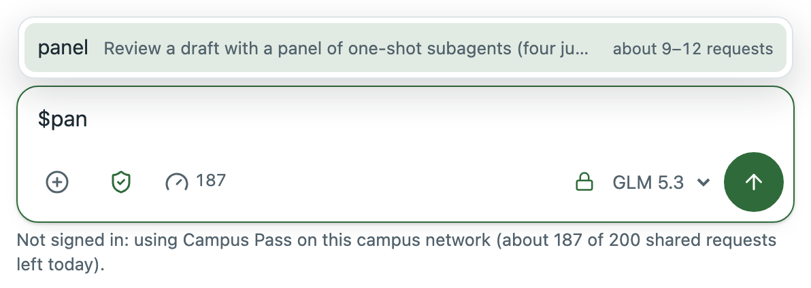 
<b>G1</b> ok · <b>D22</b> ok. $ completes skills: "Use the panel skill." starts a review panel on the open draft. <i>Scripted reenactment with a fake model.</i>
<!-- /wt -->

<!-- wt:shot panel-oneshot -->
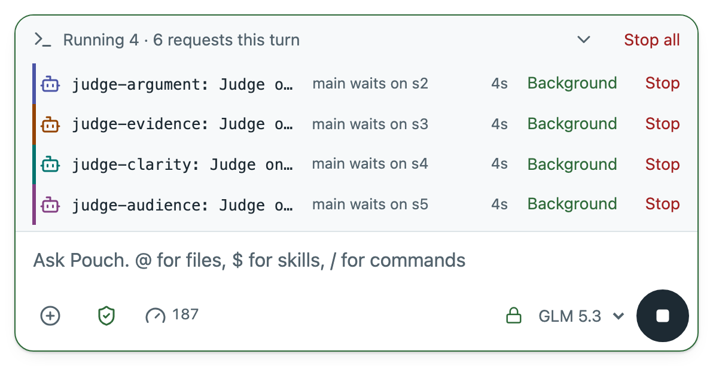 
<b>G1</b> ok · <b>D21</b> ok · <b>D21.2</b> ok. The skill runs four one-shot judges in one round (one request each, no tools), then a one-shot chair; the tray counts the requests as they go. <i>Scripted reenactment with a fake model.</i>
<!-- /wt -->

<!-- wt:shot panel-joined -->
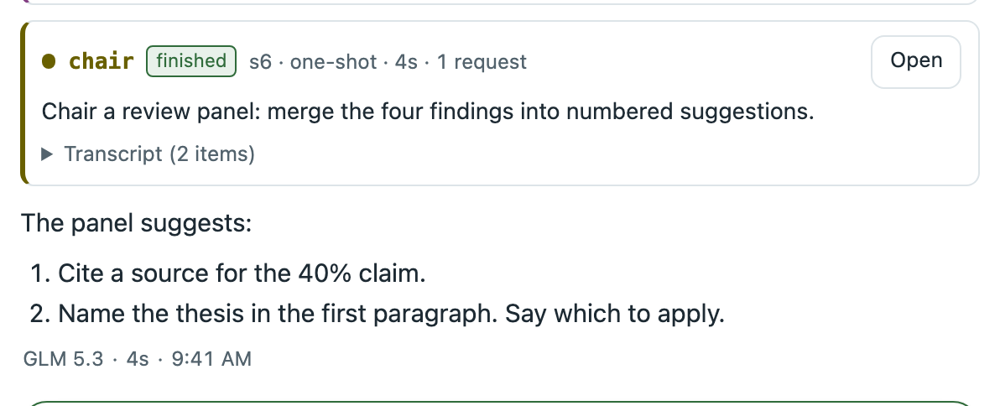 
<b>G1</b> ok · <b>G7</b> ok. Each one-shot keeps a compact card in its color; main shows the chair's merged suggestions and asks which to apply. <i>Scripted reenactment with a fake model.</i>
<!-- /wt -->

The agent graph below is the general mechanism the skill used to drive, now asked for by
hand: a scripted reenactment of the one real Sealed run (glm-5-3, 24 requests, 65 s).
Main spawns a chair with only the draft mounted read-only, then four judges in one
round. All five nest under the session.

<!-- wt:shot graph-sidebar -->
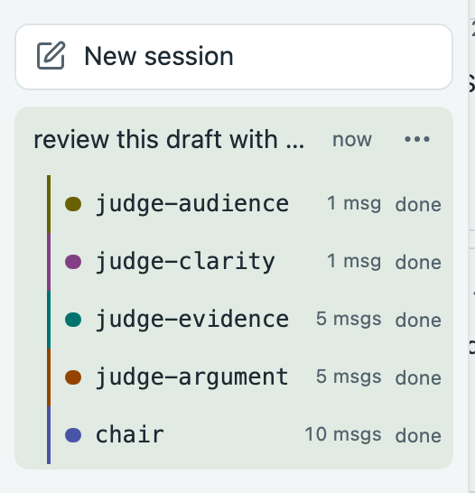 
<b>G2</b> ok · <b>G3</b> ok · <b>G6</b> ok. Main spawns a chair, then four judges in one round; all five nest under the session with live states. <i>Scripted reenactment with a fake model.</i>
<!-- /wt -->

The chair's header counts messages per edge. The judges report to the chair by id,
the two who disagree argue it out directly, and the chair sends one review. In the
real run the chair never used `list` and found no disagreement, so the peer exchange
shown here (G5) has only been exercised by the fake.

<!-- wt:shot graph-chair -->
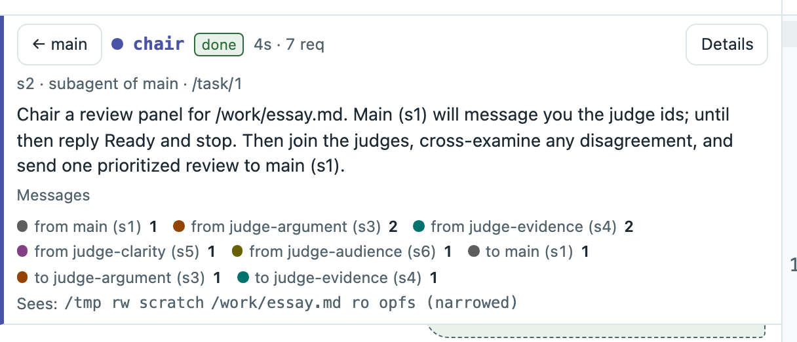 
<b>G4</b> ok · <b>G5</b> ok · <b>G9</b> ok. The chair hears from each judge by id, cross-examines the two who disagree, and sends one review to main. <i>Scripted reenactment with a fake model.</i>
<!-- /wt -->

Main sees only the chair's review. No judge text reaches it. Main then offers
numbered suggestions to apply. There is no graph visualization (by decision), and
main itself cannot be joined.

<!-- wt:shot graph-review -->
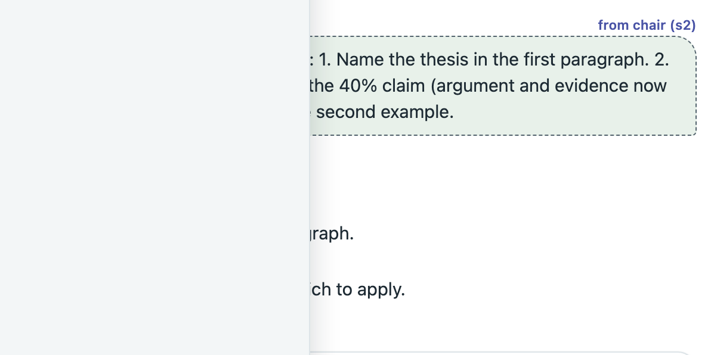 
<b>G7</b> ok · <b>G8</b> ok. Main receives only the chair review (no judge text reaches it) and offers numbered suggestions to apply. <i>Scripted reenactment with a fake model.</i>
<!-- /wt -->

## 8. Sending while Pouch works

<!-- wt:status D24 D25 D26 D27 D28 D29 D30 --><b>D24</b> ok · <b>D25</b> ok · <b>D26</b> ok · <b>D27</b> ok · <b>D28</b> ok · <b>D29</b> ok · <b>D30</b> ok<!-- /wt -->

While a turn runs, Enter steers: the message is read after the current step.
Alt+Enter queues it for after the turn. The split button offers both, plus Stop and
send. In Firefox this is unverified.

<!-- wt:shot sendmode-menu -->
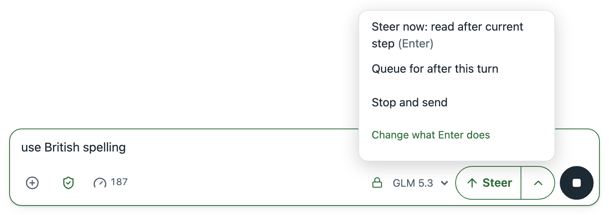 
<b>D26</b> ok · <b>D25</b> ok. While Pouch works, Enter steers (read after the current step), Alt+Enter queues for after the turn; the menu offers both and Stop and send.
<!-- /wt -->

Pending input waits in the tray, where you can cancel it, edit it or promote it.

<!-- wt:shot sendmode-tray -->
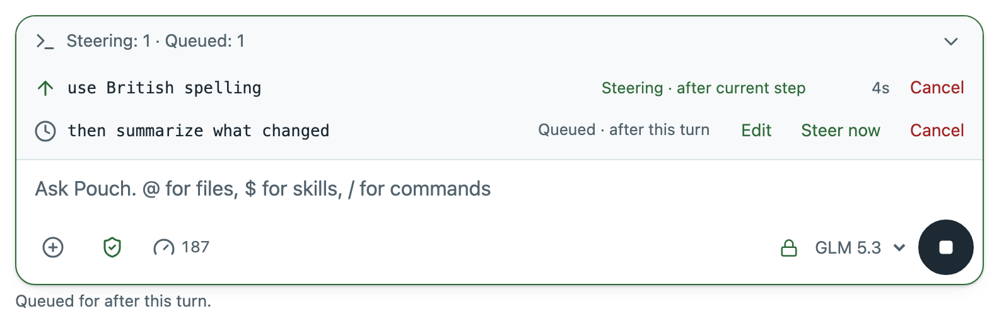 
<b>D27</b> ok · <b>D21.2</b> ok. Pending input waits in the tray, where it can be cancelled, edited or promoted.
<!-- /wt -->

Stop never sends. Unread steering and the queued message become one paused item.

<!-- wt:shot sendmode-paused -->
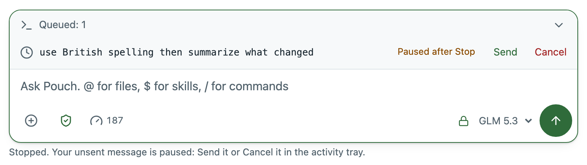 
<b>D29</b> ok. Stop never sends: unread steering and the queued message become one paused item.
<!-- /wt -->

## 9. Watching files: Desk and Analyst

<!-- wt:status G13 G14 G15 G16 G17 Mechanics --><b>G13</b> ok · <b>G14</b> ok · <b>G14.2</b> ok · <b>G15</b> ok · <b>G16</b> ok · <b>G17</b> ok · <b>Mechanics</b> ok<!-- /wt -->

A scripted reenactment. "I will revise it myself first." Main watches the file for
your changes, says so in one line, and the tray shows the watch.

<!-- wt:shot watch-tray -->
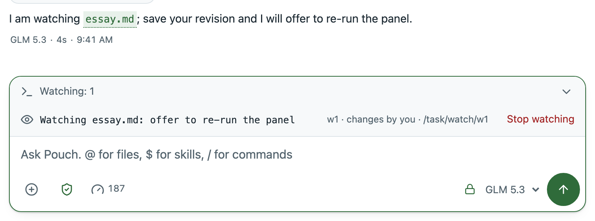 
<b>G13</b> ok. Asked to wait for your revision, main watches the file and says so in one line; the tray shows the watch. <i>Scripted reenactment with a fake model.</i>
<!-- /wt -->

Your save wakes main with a one-line event and your note, never the file's text.

<!-- wt:shot watch-woken -->
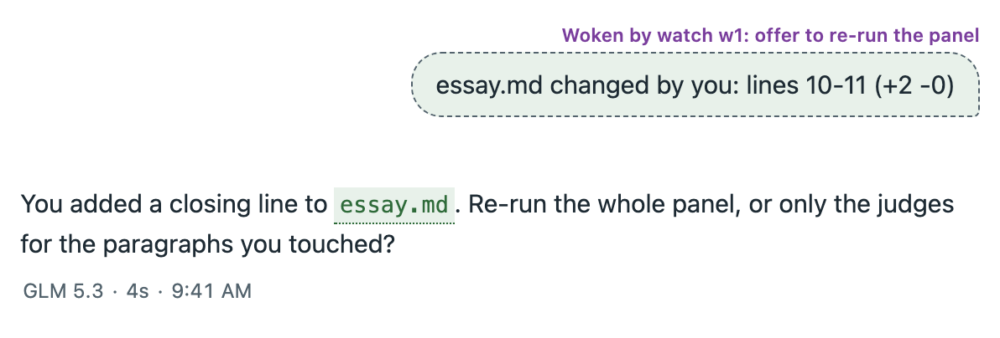 
<b>G14</b> ok · <b>G14.2</b> ok. Your save wakes main with a one-line event (no file text) and your note; it offers the next step. <i>Scripted reenactment with a fake model.</i>
<!-- /wt -->

"They are not here yet": main waits for files instead of polling. In the real run
(glm-5-3) it chose a persistent watch rather than `once`, which sidestepped an open
issue: a `once` watch announces only the first of several dropped files. Mounted
folders edited on disk are not noticed until a reload.

<!-- wt:shot watch-waiting -->
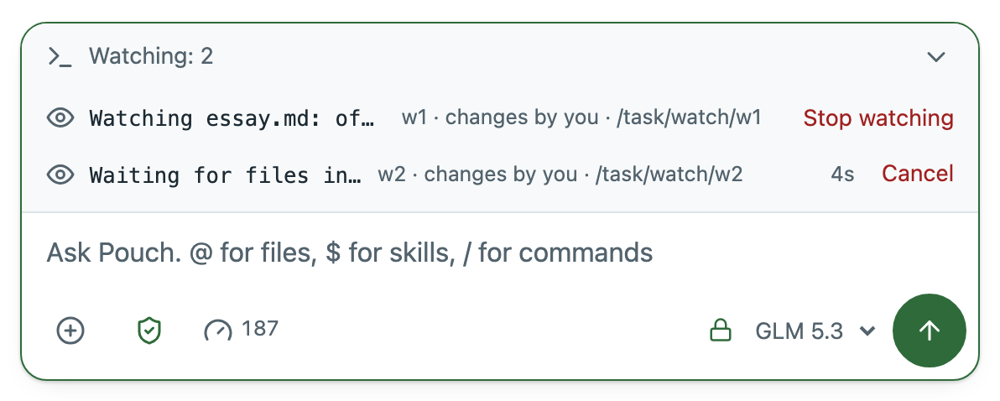 
<b>G16</b> ok. Files not here yet: main waits for them instead of polling, and the tray says what it is waiting for. <i>Scripted reenactment with a fake model.</i>
<!-- /wt -->

## 10. Offline, install, and the Local lane: Commuter

<!-- wt:status F1 F2 F3 F4 F5 --><b>F1</b> ok · <b>F2</b> ok · <b>F3</b> ok · <b>F4</b> built · <b>F5</b> ok in Chromium, gap elsewhere<!-- /wt -->

When the network drops, files, the editor, archives and `run` keep working. The
shield turns grey, and the status line says plainly that the model is unreachable.
Your draft stays.

<!-- wt:shot offline-composer -->
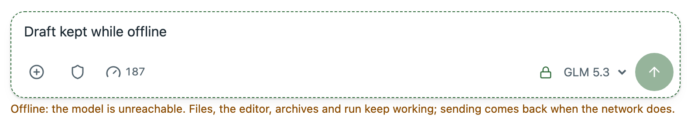 
<b>F1</b> ok. When the network drops, files, editor and run keep working; the composer says plainly that the model is unreachable.
<!-- /wt -->

The Local lane runs a small model on this device and sends nothing. Here the WebGPU
model is replaced by a scripted stand-in, `walkthrough/fake-local.js`, so this is a
reenactment. The real provider still parses its tool calls and runs the tools.
Switching lanes is always explicit. The offline copy and installing (F3, F5) need a
served service worker and are not illustrated yet.

<!-- wt:shot local-turn -->
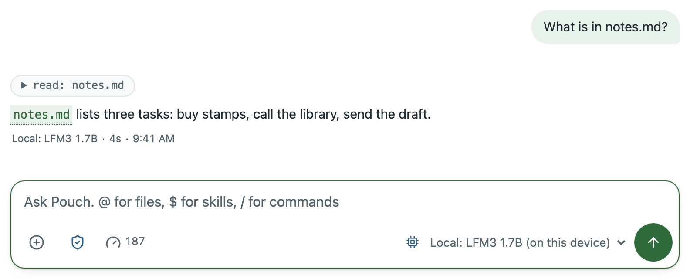 
<b>F4</b> built. The Local lane answers and runs tools on this device with nothing sent; switching lanes is always explicit. <i>Scripted reenactment with a fake model.</i>
<!-- /wt -->

## 11. On a phone

<!-- wt:status D17 D20.2 D21.2 A8 R6 --><b>D17</b> ok · <b>D20.2</b> ok · <b>D21.2</b> ok · <b>A8</b> ok · <b>R6</b> built, untested<!-- /wt -->

The same composer fits a 390px-wide screen with 44px targets. There has been no
real-phone session yet (R6).

<!-- wt:shot phone-composer -->
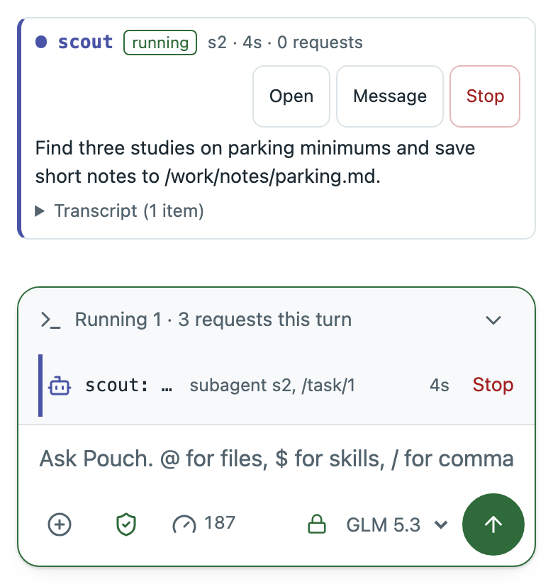 
<b>D17</b> ok · <b>D20.2</b> ok · <b>D21.2</b> ok. On a phone the same composer fits 390px with 44px targets.
<!-- /wt -->

<!-- wt:shot phone-composer-dark -->
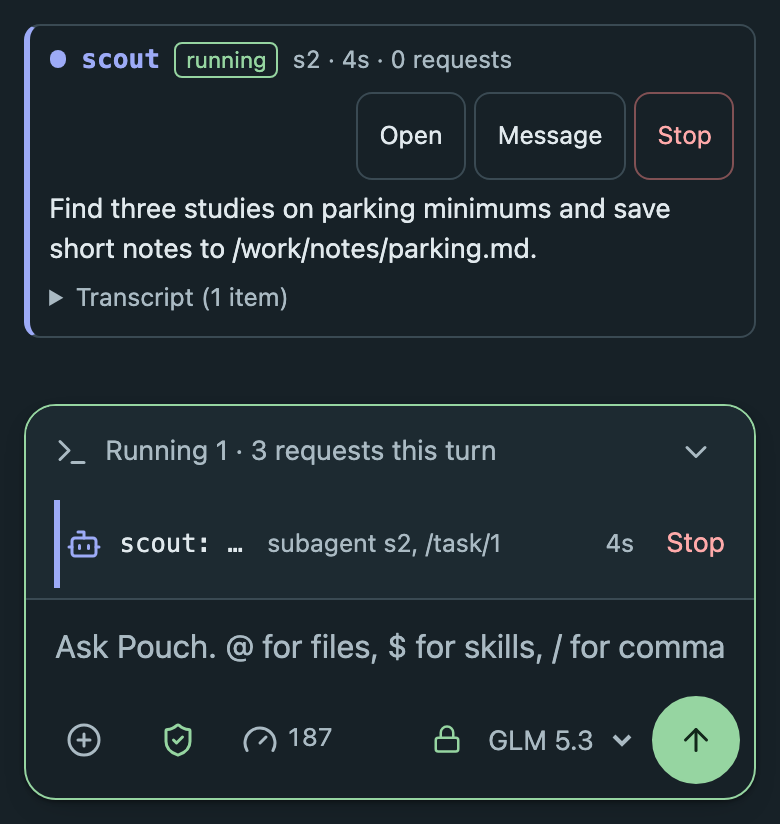 
<b>A8</b> ok · <b>D17</b> ok. Light, Dark or System appearance, from Settings.
<!-- /wt -->

## 12. Leaving

<!-- wt:status L1 L3 L4 O1 O2 O3 O4 --><b>L1</b> ok · <b>L3</b> ok · <b>L4</b> built, untested · <b>O1</b> ok · <b>O2</b> ok · <b>O3</b> ok · <b>O4</b> ok<!-- /wt -->

Erase all removes everything this site stored in the browser, and the reloaded page
says so.

<!-- wt:shot leave-erased -->
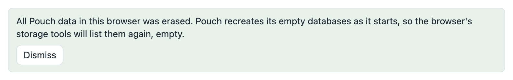 
<b>L1</b> ok. Erase all removes every trace this origin stored, and the reloaded page says so.
<!-- /wt -->

## Coverage

<!-- wt:coverage -->
62 of 104 stories in [JOURNEYS.md](JOURNEYS.md) are illustrated. JOURNEYS.md reuses D20, D21, G14, D19 for different stories; a second use is written with .2 here (D20.2).

**Not yet illustrated**

- 1. Arrive: A3 (untested), A4 (ok)
- 3. Bring files in: I1 (ok), I2 (ok), I3 (untested), I4 (ok), I5 (ok), I7 (untested), I9 (ok), I10 (ok)
- 4. Direct the agent: D4 (ok), D5 (untested), D6 (untested), D7 (ok), D24 (ok), D28 (ok), D30 (ok), D14 (untested), D16a (ok)
- Agent graphs: G10 (ok), G11 (ok), G12 (ok), Caps (ok)
- Watching files: G15 (ok), G17 (ok), Mechanics (ok)
- 5. Review: R2 (dropped by decision 2026-10-29), R3 (dropped by decision 2026-10-29), R5 (dropped by decision 2026-10-29), R6 (untested), R8 (ok)
- 6. Take files out: O1 (ok), O2 (ok), O3 (ok), O4 (ok), O5 (untested), O6 (gap)
- 7. Leave: L2 (ok), L4 (untested)
- 8. Work offline: F2 (ok), F3 (ok), F5 (ok in Chromium, gap elsewhere)
<!-- /wt -->

**Gaps found while building this walkthrough.** The trust panel's mount tables used to
size their label column to the longest task label and push the mounts off the edge;
fixed in Batch B (stacked blocks), so the `ns-trust` shot no longer widens the panel.
